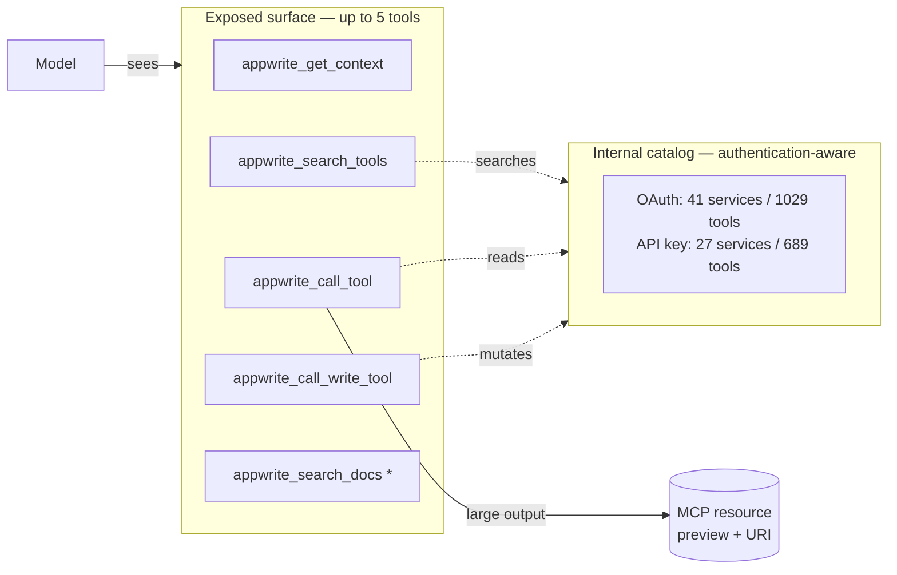

# Tool surface

The server boots in a compact workflow: the MCP client sees a small
operator-style surface while the full Appwrite catalog stays internal and is
searched at runtime.

`*` `appwrite_search_docs` is registered only when the docs index **and**
`OPENAI_API_KEY` are present — see [Documentation search](documentation-search.md).

## Exposed tools

| Tool | What it does |
| --- | --- |
| `appwrite_get_context` | Workspace summary. API key → project + readable service totals/samples. OAuth → also account, organization, discovered projects. A project in focus lists its environments; `environment_id` summarizes one of them instead. |
| `appwrite_search_tools` | Searches the internal catalog at runtime. |
| `appwrite_call_tool` | Runs a read catalog tool (`list`, `get`). |
| `appwrite_call_write_tool` | Runs every other catalog tool (create, update, delete, upsert, unknown verbs). Requires `confirm_write=true` and a `reason`. |
| `appwrite_search_docs` | Semantic search over Appwrite docs (conditional — see above). |

## Behavior

- **Large outputs** are stored as an MCP resource and returned as preview text
  plus a resource URI.
- **Reads and writes** go through separate tools so each tool's annotations
  match every call it accepts: `appwrite_call_tool` is read-only and
  idempotent, `appwrite_call_write_tool` is destructive. Each search result
  names its `call_tool`, and calling a tool through the other one returns an
  error naming the right one.
- **Writes** require `confirm_write=true` and a `reason`: one line, at most 256
  characters, saying why the change is made. It is sent as `X-Appwrite-Reason`
  (percent-encoded like `encodeURIComponent`), and Appwrite records it on the
  project's audit log, shown in the Activity tab next to the change. A reason
  Appwrite would refuse (blank, too long, or with line breaks or other control
  characters) is refused before any request is made. Reads send no reason.
- **Environments**: `appwrite_call_tool`, `appwrite_call_write_tool`,
  `appwrite_get_context` and `appwrite_show` take an optional `environment_id`
  to act in one of a project's environments (Appwrite Cloud). It is sent as
  `X-Appwrite-Environment` together with the project's own ID in
  `X-Appwrite-Project`, since an environment's project ID is internal, and
  needs `project_id` on the hosted server. `appwrite_get_context` with
  `project_id` lists the project's environments (with the `project.read` scope;
  self-hosted Appwrite has none). Over stdio the environment is fixed by
  `APPWRITE_ENVIRONMENT_ID`, and a call naming another one is refused.
- **Annotations**: every exposed tool sets a `title` and all four hints
  (`readOnlyHint`, `destructiveHint`, `idempotentHint`, `openWorldHint`)
  explicitly, as the Anthropic and OpenAI connector directories require.
- **Target context** is included in search results as `context=console`,
  `context=organization`, or `context=project`. Hosted calls enforce the required
  top-level `organization_id` or `project_id` before making a request.
- **Access** is still gated per-route by the scopes granted to the OAuth token.
- **Hosted OAuth** registers all 41 services and 1029 methods shipped by
  `appwrite-console` 0.12.0. This adds console control-plane services including
  projects, organizations, domains, migrations, dedicated databases, usage, VCS,
  vectors, WAF, notifications, and regions.
- **API-key stdio** deliberately registers only the 689 project-key-compatible
  methods across 27 services. It includes the new DocumentsDB, VectorsDB, and
  text-embeddings APIs, while console administration methods remain hidden.
- **Registration** remains SDK-driven, with the authentication profile policy
  applied while the internal catalog is built.
